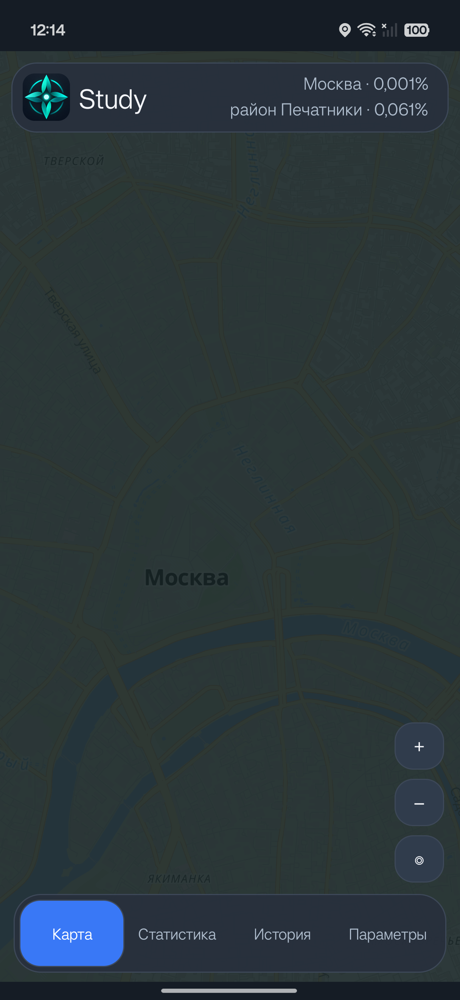
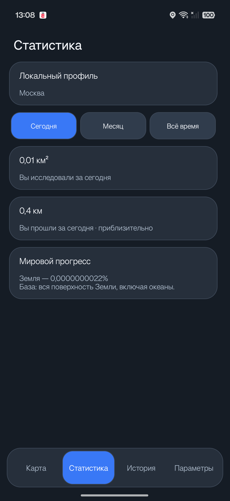
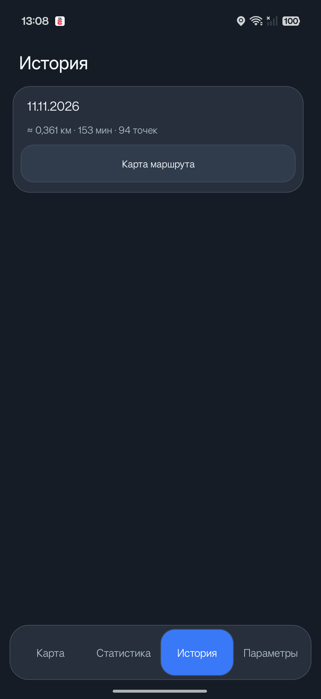
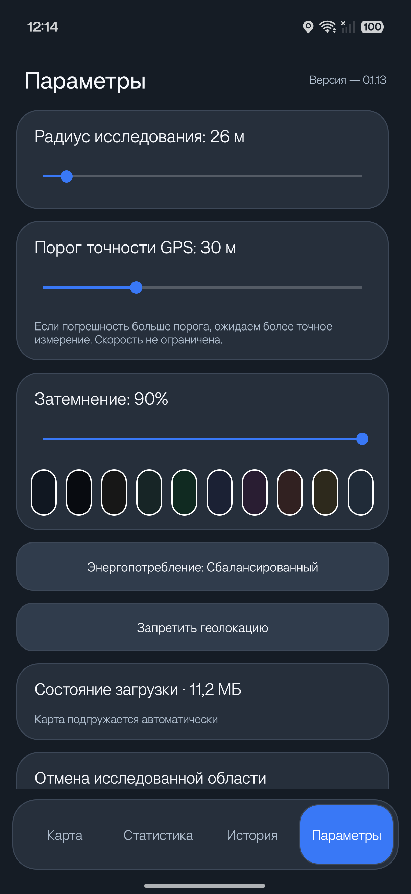

# Study 0.2.0

Приложение Android для исследования реального мира

[Скачать актуальную версию APK](https://github.com/AlemusSs/Study/releases/latest/download/Study-latest.apk) · [История выпусков и даты](https://github.com/AlemusSs/Study/releases) · [Telegram](https://t.me/alemus_ii)

Релиз **0.2.0**, исправленная сборка **21**, 11 ноября 2026. Полный перечень подтверждённых возможностей и ограничений — в [описании выпуска](https://github.com/AlemusSs/Study/releases/tag/v0.2.0).

## Возможности

- Карта мира MapLibre/OpenFreeMap с затемнением неисследованной территории.
- Открытие территории вокруг принятых GPS-координат, локальное сохранение прогресса.
- Радиус 20–100 м, порог погрешности 1–100 м, цвет и непрозрачность маски.
- История по календарным дням: линии маршрута и открытые за день области.
- Приблизительные расстояние (один знак в км), площадь (два знака в км²) и статистика по периодам.
- Выбор дней истории удержанием 3 секунды с вибрацией, удаление выбранных дней с сохранением исследованной территории.
- Ползунки и кнопки −/+ для радиуса, погрешности и затемнения.
- Фоновое исследование с системным уведомлением.
- Автоматическая проверка выпусков GitHub при запуске, название/версия/дата в окне обновления, добровольная загрузка с процентами и системная установка с подтверждением Android.

## Установка и обновление

Android 8.0 или новее. Скачайте **Study-latest.apk** из последнего выпуска и откройте файл. Android может попросить разрешить установку из выбранного источника. Разрешите геолокацию и уведомления для исследования. Точность местоположения зависит от устройства и условий приёма.

Начиная с 0.1.12 приложение проверяет обновления при запуске; вручную — «Параметры → Проверить обновления». Можно отказаться и продолжить работу на прежней версии. Для замены предыдущей сборки 0.2.0 скачайте актуальный APK и установите его поверх: прежняя сборка может не распознать обновление с тем же названием версии. При согласии APK загружается, проверяется и открывается системный установщик. При первой установке обновления из Study Android может потребовать отдельное разрешение. **Окончательную установку подтверждает пользователь в Android.** При обновлении не удаляйте прежнюю Study: установка поверх сохраняет её локальные данные.

В выпусках размещается только APK актуальной версии; прошлые описания и даты сохраняются. Исходный код в этом репозитории не публикуется. Автоматически создаваемые GitHub архивы содержат только публичные материалы этого репозитория.

## Ограничения и данные

Версия 0.2.0 — релиз, проверенный на CPH2723 с Android 16; совместимость со всеми устройствами и длительные полевые сценарии ещё не подтверждены. Расстояние и площадь приблизительные. Дрейф GPS может завышать расстояние, редкие измерения и фильтрация — занижать. Длинные потери сигнала не соединяются. Запись GPS и прогресса локальная и не требует интернета; подложка карты требует сети или сохранённых данных. Полные офлайн-карты стран, резервное копирование и перенос прогресса между телефонами пока не реализованы.

Для карты используются серверы OpenFreeMap/OpenStreetMap; названия и границы территорий запрашиваются у Nominatim по центру просматриваемой карты, с кэшем. Проверка обновлений обращается к GitHub; координаты в запросы обновлений не включаются. GitHub и картографические сервисы видят обычные сетевые сведения соединения.

После обновления до 0.2.0 схема базы становится версией 3. Откат на 0.1.x поверх этой базы не поддерживается. Удаление дня из истории сохраняет сведения, необходимые для открытых территорий; оно не является обещанием безвозвратного стирания всех пространственных данных.

## Источники и лицензии

MapLibre Native — BSD-2-Clause; OpenFreeMap / OpenMapTiles; © OpenStreetMap contributors — ODbL; JTS — EPL-2.0 / EDL-1.0; OkHttp — Apache-2.0. Подробнее: https://www.openstreetmap.org/copyright . Эти лицензии относятся к компонентам и картографическим данным; отсутствие исходников Study в этом репозитории не означает передачу прав на приложение.

## Интерфейс

Карта центрирована на Москве.

